# JollyRx — B2B Pharmaceutical Contract Manufacturing Marketplace

[](docs/testing.md)
[](docs/zoho-setup.md)
[](docs/security.md)

**JollyRx** is an enterprise-grade B2B pharmaceutical marketplace prototype connecting buyers with certified contract manufacturing plants while strictly protecting confidential manufacturer identities.

The system decouples private manufacturing records inside an internal **Zoho Creator Vault** from an anonymized, quotation-driven public **Zoho Commerce Storefront**, bridged by an idempotent synchronization engine and an authenticated, rate-limited RFQ gateway.

---

## Architecture at a Glance

```mermaid
flowchart LR
  Vault["Private Plant Vault\n(Zoho Creator)"] --> Formulations["Internal Formulations\n(Lookup + Confidential Molecule)"]
  Formulations --> Sync["Allowlist Sync Engine\n(Deluge / Node.js)"]
  Sync --> Commerce["Anonymized Catalog\n(Zoho Commerce)"]
  Commerce --> Storefront["B2B Custom Storefront\n(No Prices / No Cart / RFQ-Only)"]
  Storefront --> Modal["Request Quote Modal\n(Prefilled Masked Node ID)"]
  Modal --> Gateway["Secure RFQ Gateway\n(Rate-Limited / Deduplicated)"]
  Gateway --> Inquiries["RFQ Inquiries\n(Stored in Zoho Creator)"]
```



---

## Core Components

1. **Internal Plant Vault (Zoho Creator)**:
   - Contains confidential records for three fictional plants across Baddi, Gujarat, and Maharashtra.
   - Stores real plant names, factory addresses, drug licences (`DEMO-LIC-*`), site master files, and chemical molecules (`Paracetamol`, `Amoxicillin`, `Ceftriaxone`).
   - Implements immutable synthetic Masked Node IDs (`NODE-BD-01`, `NODE-GJ-02`, `NODE-MH-03`).
   - Validated via Deluge scripts to prevent dangling lookups, negative MOQs, or immutable ID tampering.
2. **B2B Public Storefront (Zoho Commerce)**:
   - Customized responsive theme section displaying only approved public fields: **Masked Node ID**, **Dosage Form**, **Certification**, and **MOQ**.
   - Completely suppresses retail pricing, Add to Cart buttons, and checkout flows.
   - Features responsive cards, accessible dialogs, and instant RFQ modals.
3. **Dual Synchronization Pathways**:
   - **In-Platform Deluge Function** ([sync-to-commerce.deluge](creator/deluge/sync-to-commerce.deluge)): Uses Creator Connections (`invokeurl`) to synchronize products natively.
   - **Single-Writer CLI Runner** ([sync.js](integration/src/sync.js)): External Node.js tool enforcing process locks, state-machine tracking, and SKU reconciliation.
4. **Secure RFQ Intermediary Gateway ([server.js](integration/src/server.js))**:
   - Validates all buyer inputs server-side (types, lengths, email syntax).
   - Enforces strict CORS matching the storefront origin.
   - Sliding-window IP rate limiting (6 RFQs/min, 60 catalog requests/min).
   - Invisible honeypot field to drop automated bot submissions.
   - Canonical SHA-256 fingerprinting to deduplicate concurrent requests.

---

## Verification & Automated Testing

Run the test suite from the repository root:

```bash
node --test integration/test/integration.test.js
```

### Test Results Summary (15/15 Passing)
- ✅ Input Validation: Rejects empty name, invalid email, zero/negative/fractional quantities, SQL/Deluge injection, and XSS payloads.
- ✅ Bot Defense: Drops submissions with populated honeypot field.
- ✅ Data Allowlisting: Verifies that public catalog responses contain strictly 4 fields with proper CORS headers.
- ✅ Error Masking: Ensures upstream failures return generic 503 responses without exposing database credentials or stack traces.
- ✅ Rate Limiting: Verifies HTTP 429 after 6 RFQ requests from the same IP.
- ✅ Replay Protection: Concurrent identical requests resolve to exactly 1 database write.
- ✅ Sync Idempotency: Synchronizes products, stores confirmed IDs, and safely reconciles on re-run without duplicate creation.

---

## Project Structure & Documentation

```
jollyrx/
├── README.md                      # Executive overview & quickstart
├── docs/
│   ├── architecture.md            # System architecture, sequence diagrams & field mapping
│   ├── security.md                # Threat model, data leakage audit & access matrix
│   ├── zoho-setup.md              # Step-by-step Creator & Commerce configuration
│   ├── api-integration.md         # API endpoints, OAuth scopes & recovery protocol
│   ├── deployment.md              # RFQ gateway hosting, sync job & theme installation
│   ├── testing.md                 # Full test matrix, evidence & local browser checks
│   ├── demo.md                    # 3-minute video presentation script (0:00–3:00)
│   ├── ai-usage.md                # Comprehensive AI usage & engineering judgment report
│   └── submission.md              # Final submission checklist & acceptance criteria
├── creator/
│   ├── schema/
│   │   └── model.md               # Forms, fields, lookup relationships & report link names
│   ├── deluge/
│   │   ├── seed.deluge            # Seeds the 3 fictional plants & formulations
│   │   ├── validate-plant.deluge  # Enforces regex & immutable node IDs
│   │   ├── validate-formulation.deluge # Enforces plant lookup & positive MOQ
│   │   ├── validate-rfq.deluge    # Enforces formulation link & positive quantity
│   │   ├── stamp-sync.deluge      # Audit timestamping for sync operations
│   │   └── sync-to-commerce.deluge# In-platform Deluge sync via invokeurl
│   └── sample-data/
│       └── plants.csv             # Reference fictional demonstration data
├── commerce/
│   ├── theme/
│   │   └── jollyrx.html           # Accessible B2B catalog & RFQ dialog markup
│   ├── css/
│   │   └── jollyrx.css            # Responsive, enterprise medical design palette
│   ├── js/
│   │   └── jollyrx.js             # Zero-dependency async catalog & RFQ controller
│   └── build-section.mjs          # Injects gateway origin & compiles custom section
└── integration/
    ├── src/
    │   ├── server.js              # Production HTTP server with rate limiting & CORS
    │   ├── rfq.js                 # Input validation, catalog read & Creator insertion
    │   ├── sync.js                # Single-writer idempotent Commerce synchronizer
    │   └── zoho.js                # OAuth token management & Creator/Commerce client
    ├── test/
    │   └── integration.test.js    # 15 hermetic integration tests
    ├── tools/
    │   └── browser-check.mjs      # Headless Chrome multi-viewport renderer
    ├── package.json               # Node.js project manifest (Node 22+)
    └── .env.example               # Template for environment variables & secrets
```

---

## Deployment & Live Verification Steps

1. **Configure Zoho Creator**:
   - Follow [Zoho Setup Guide](docs/zoho-setup.md) to create the app and 4 forms (`Plant_Master`, `Formulations`, `RFQ_Inquiries`, `Sync_Logs`).
   - Paste Deluge validation workflows and execute `seed_demo()` to populate the 3 fictional plants.
2. **Deploy the RFQ Service**:
   - Deploy `integration/src/server.js` to your HTTPS host (e.g. Render, Railway, or VM).
   - Configure environment variables from `.env.example` using your Zoho Self Client OAuth credentials.
3. **Synchronize Catalog to Zoho Commerce**:
   - Run `npm run sync` from `integration/` (or execute `sync_all_pending_formulations` in Creator).
   - Confirm 3 products created with matching Masked Node IDs in Zoho Commerce admin.
4. **Install Theme Custom Section**:
   - Run `node commerce/build-section.mjs https://YOUR-RFQ-GATEWAY-HOST`.
   - Paste into a Custom Code section on your Zoho Commerce homepage.
   - Verify out-of-stock purchase restriction is enabled and native prices/cart blocks are hidden.
5. **Verify and Record**:
   - Follow [Testing Guide](docs/testing.md) to verify end-to-end flow in a clean browser.
   - Record the 3-minute demonstration using [Demo Script](docs/demo.md).
