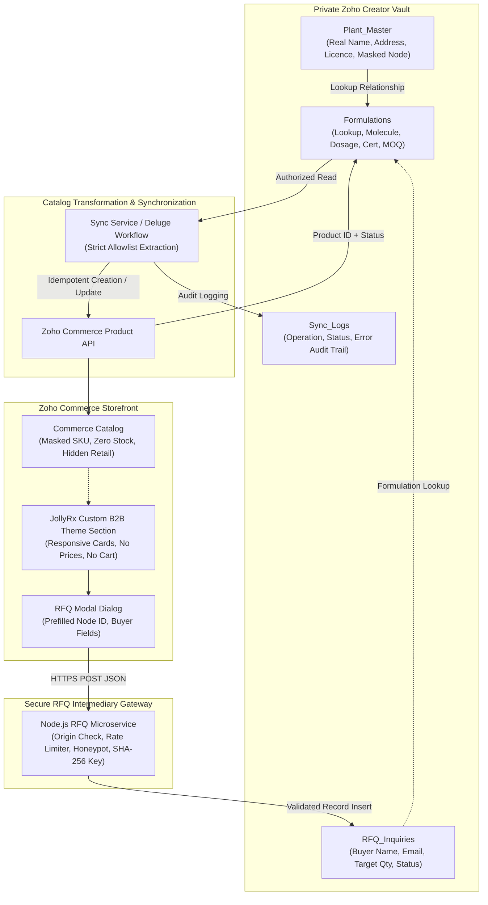
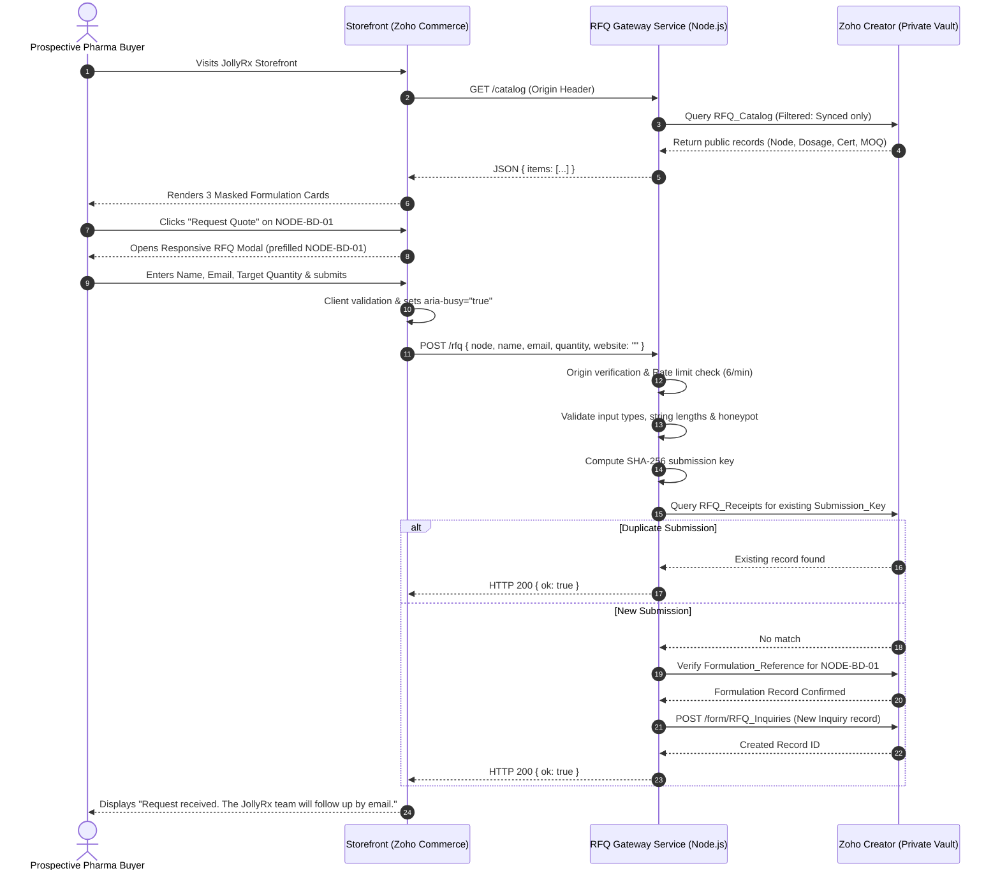

# JollyRx System Architecture & Design Specification

This document provides the technical architecture, data flows, integration pathways, and component specifications for the **JollyRx B2B Pharmaceutical Contract Manufacturing Platform**.

---

## 1. System Overview & Architecture Diagram

JollyRx operates on a decoupled two-tier architecture:
1. **Internal Private Vault (Zoho Creator)**: Secure repository holding sensitive manufacturer records, regulatory licences, plant locations, and confidential formulations.
2. **Public B2B Storefront (Zoho Commerce)**: Buyer-facing catalog showcasing sanitized manufacturing capabilities, masked node identifiers, dosage forms, certifications, and MOQs with an RFQ-only purchasing workflow.

---

## 2. End-to-End Sequence Diagram

---

## 3. Mandatory Commerce Field Mapping & Allowlisting

Zoho Commerce requires specific fields upon product creation (`name`, `url`, `variant_type`, and initial `variants`). To comply with platform requirements without leaking manufacturer secrets:

| Zoho Commerce Field | JollyRx Value | Security & Compliance Rationale |
| :--- | :--- | :--- |
| `name` | `Masked_Node_ID` (e.g. `NODE-BD-01`) | Prevents manufacturer name or chemical molecule from appearing as the product title. |
| `url` | Lowercase Node ID (e.g. `node-bd-01`) | Deterministic, nonconfidential URL slug. |
| `product_short_description` | `"Dosage form: Tablets \| Certification: WHO-GMP \| MOQ: 50000"` | Safe public summary string generated strictly from allowlisted attributes. |
| `product_description` | `"
Dosage form: Tablets \| ...
"` | HTML description containing only public fields. |
| `variant_type` | `"inventory"` | Required by Zoho Commerce for variant configuration. |
| `show_in_storefront` | `false` | Hides the native retail item from standard store collections and search results. |
| `variants[0].sku` | `Masked_Node_ID` | Safe unique SKU identifier. |
| `variants[0].rate` | `"1"` | Zoho Commerce enforces positive price validation on variant creation; nominal rate is suppressed in UI. |
| `variants[0].initial_stock` | `"0"` | Zero inventory prevents accidental checkout flows. |

---

## 4. Retail Workflow Suppression Strategy

Standard e-commerce workflows (Add to Cart, Buy Now, Cart Drawer, Shopping Bag, Retail Checkout, Pricing Badges) are strictly incompatible with B2B contract manufacturing:
1. **Inventory Gating**: All synchronized variants are initialized with `initial_stock: 0` and the store preference is set to **Restrict out-of-stock purchases**. This guarantees that even if a buyer attempts to trigger a native checkout URL, the platform blocks transaction progression.
2. **Template Customization**: In the Zoho Commerce Theme Editor:
   - Price blocks and Add to Cart action buttons are removed from product templates.
   - Header navigation links to Cart and Wishlist are suppressed.
   - Retail payment gateways (Stripe, PayPal, Razorpay) remain disabled in the demo store.
3. **Dedicated B2B Section**: The storefront homepage uses the custom JollyRx section (`commerce/build-section.mjs`), which renders custom cards with an explicit "Request Quote" button opening the asynchronous RFQ modal.

---

## 5. Idempotent Synchronization & Error Recovery

Synchronization between Creator and Commerce operates under strict idempotency guarantees:
- **Lock Protection**: External sync scripts enforce single-writer execution via local process locks (`sync.lock.local`).
- **State Machine**:
  - `Pending`: Initial state after formulation creation or manual reset.
  - `Creating`: Transitional state stamped before initiating the initial Commerce `POST`. Prevents duplicate creations if a network timeout occurs mid-flight.
  - `Synced`: Product ID confirmed and recorded in Creator. Subsequent syncs execute `PUT /products/{id}`.
  - `Error`: Failure state. Logged to `Sync_Logs` with root-cause diagnostic message.
- **Reconciliation Protocol**: If a formulation is in `Creating` state without a confirmed `Commerce_Product_ID`, the engine stops and flags the item for operator reconciliation by SKU before retrying.

---

## 6. Access Control & Scopes Matrix

| Service | Scopes / Permissions | Destination / Target |
| :--- | :--- | :--- |
| **RFQ Gateway** | `ZohoCreator.report.READ` | Read `RFQ_Catalog` (public fields) & `RFQ_Receipts` (receipt hash) |
| **RFQ Gateway** | `ZohoCreator.form.CREATE` | Insert into `RFQ_Inquiries` |
| **Catalog Sync** | `ZohoCreator.report.READ`, `UPDATE` | Read and update `Sync_Formulations` |
| **Catalog Sync** | `ZohoCreator.form.CREATE` | Insert execution logs into `Sync_Logs` |
| **Catalog Sync** | `ZohoCommerce.items.CREATE`, `UPDATE`| Create and update products in Zoho Commerce |
